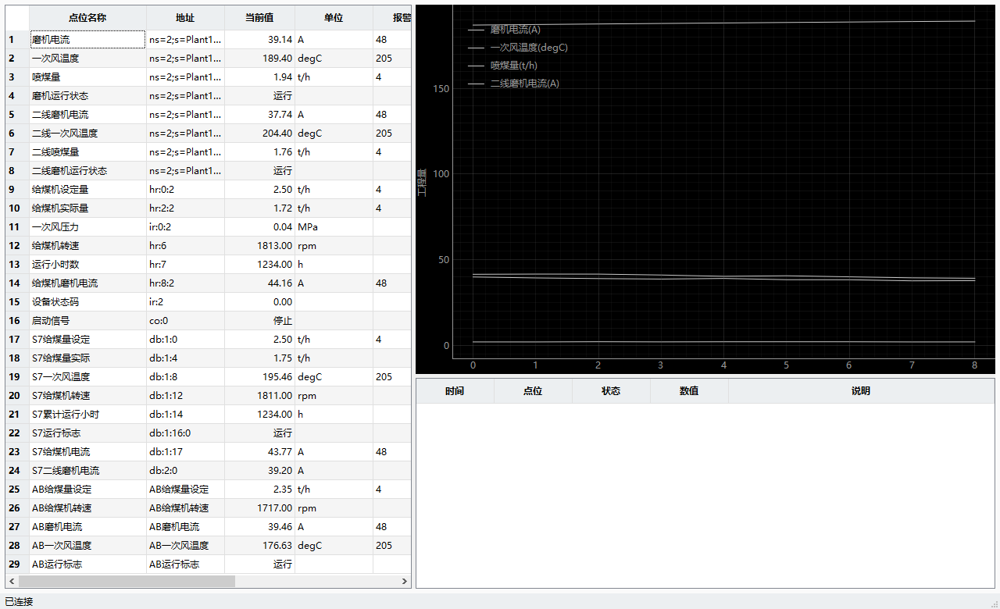
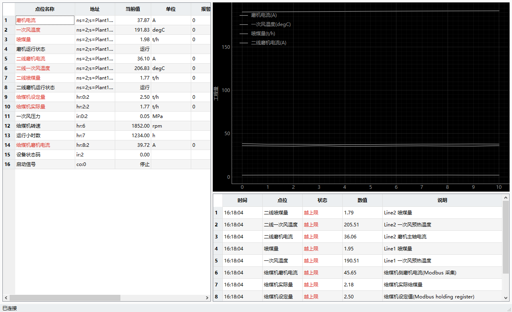

# scada-ai —— 上位机 + AI 融合项目

配合 `上位机AI融合学习路线.md` 走。目标: 用 Python 搭一套多协议工业数据采集底座,
再通过 MCP 把现场数据接给大模型。



> 上图是**一张点表同时挂四种协议**的运行画面, 29 个点位一个采集器:
> 1-8 行 **OPC UA**(`ns=2;s=...`) · 9-16 行 **Modbus**(`hr:`/`ir:`/`co:`) ·
> 17-24 行 **S7**(`db:1:0`) · 25-29 行 **AB EtherNet/IP**(标签名)
> 一个报警引擎, 一套 MCP 工具, 上层完全不知道底下有四种协议。

## 这个项目解决什么问题

现场数据是"散"在各种协议里的: OPC UA 服务器、西门子 PLC、Modbus 仪表、AB 控制器。
组态软件能做显示, 但**做不了推理** —— 报警一多, 老师傅的经验就没法沉淀成系统能力。

这个项目把中间那一层补上:

```
大模型 / AI 客户端
        |  MCP (stdio, JSON-RPC)
        v
  mcp_server.py        6 个工具: 点表/搜索/读值/报警/诊断/写值
        |
        v
  drivers/collector.py  常驻采集器: 订阅 -> 值缓存 -> 报警引擎 -> 历史序列
        |
        v
  drivers/  opcua_driver | modbus_driver | snap7_driver | eip_driver
        |
        v
     现场设备 (OPC UA 服务器 / 西门子 PLC / Modbus 仪表 / AB 控制器)
```

上层(界面、MCP、大模型)**只认 `Tag` 和 `Driver` 这两个抽象**, 协议差异全在驱动层被吃掉。
加一个新协议只要: 写个 driver → factory 加个分支 → 点表写 `source: xxx`, **上层一行不用改**。

> `points_all4.yaml` 就是这个设计的证据: **一张点表同时挂四种协议**,
> 29 个点位, 一个采集器, 一个报警引擎, 一套 MCP 工具, 界面和数据层完全无感。

## 当前进度

| 阶段 | 内容 | 状态 |
|---|---|---|
| 准备 | venv + 依赖 + mock OPC UA server + 验证客户端 | ✅ 跑通 |
| **阶段 1-2 核心** | **Driver 抽象层 + 点表 + 报警引擎 + PySide6 上位机** | ✅ **跑通 (2026-10-27)** |
| **阶段 3** | **MCP Server —— 现场数据接给大模型 (6 个工具)** | ✅ **跑通 (2026-10-27)** |
| **阶段 4** | **Modbus 驱动实测 + 混合协议点表** | ✅ **跑通 (2026-10-27 夜)** |
| **阶段 5** | **S7 + AB(EtherNet/IP) 驱动 + 四协议同表** | ✅ **跑通 (2026-10-28)** |
| 阶段 6 | 接真实大模型 + 证书信任 + Demo 视频 | 未开始 |



## 环境

- Python 3.11.15 (uv 托管, 基础解释器在 `%APPDATA%\uv\python\cpython-3.11-windows-x86_64-none`)
- venv: `.venv` (uv 建的; **注意 uv 的 venv 不带 pip**)
- PySide6-Essentials 6.12.0 + pyqtgraph 0.14.0 + numpy 2.4.6
- asyncua 2.1.0 / pymodbus 3.16.1 / python-snap7 3.3.0 / pycomm3 1.2.16 / mcp 2.3.0
- 平台: Windows + PowerShell

## 快速开始

```powershell
cd C:\Users\Administrator\dev\projects\scada-ai

# 终端 1: 起 mock server
.\run.ps1

# 终端 2: 跑上位机
.\run.ps1 app.py

# 终端 2 (或者): 无界面自测
.\run.ps1 test_pipeline.py
```

`run.ps1` 干三件事: `chcp 65001` + `PYTHONUTF8=1` (否则中文乱码) + 用项目 venv 的 python。

**不用 run.ps1**:
```powershell
.\.venv\Scripts\python.exe app.py
```

## 测试（mock server 脚本自己会起，不用另开终端）

```powershell
.\run.ps1 test_pipeline.py     # OPC UA 管线 + 报警引擎
.\run.ps1 test_mcp.py          # MCP 6 个工具端到端
.\run.ps1 test_modbus.py       # Modbus 驱动 + 混合协议采集
.\run.ps1 test_s7_eip.py       # S7 + AB 驱动 + 四协议同表采集
.\run.ps1 test_mcp.py --points points_mixed.yaml --with-modbus   # 混合协议下的 MCP
```

五套全绿才算过:

```
[OK]   test_pipeline.py                退出码=0   全部通过
[OK]   test_mcp.py                     退出码=0   6 个工具 + 端到端链路验证通过
[OK]   test_mcp.py --with-modbus       退出码=0   6 个工具 + 端到端链路验证通过
[OK]   test_modbus.py                  退出码=0   Modbus 驱动 + 混合协议采集全部验证通过
[OK]   test_s7_eip.py                  退出码=0   S7 + AB 驱动 + 四协议同表采集全部验证通过
```

> 测试脚本起 mock server 前会**等端口真正释放**。上一轮的 server 还在退出中时
> 端口照样能连上, 新 server 绑不上, 测试就会连到"正在死"的那个 —— 偶发失败就是这么来的。

## 上位机怎么用

| 区域 | 内容 |
|---|---|
| 左 | 点表: 点位名称 / 地址 / 当前值 / 单位 / 报警上限 / 下限 / 状态 |
| 右上 | 实时曲线 (pyqtgraph), 4 条 |
| 右下 | 报警 + SOE 顺序事件记录 |
| 底栏 | 连接状态 |

**常用参数**
```powershell
# 录屏/截图: 跑 14 秒自动截图并退出
.\run.ps1 app.py --shot shots\demo.png --shot-seconds 14

# 演示模式: 把所有报警上限压到 0, 让报警立刻触发(录 Demo 视频用)
.\run.ps1 app.py --alarm-demo

# 换点表
.\run.ps1 app.py --points points.yaml
```

**加一个点位只要改 YAML**, 代码一行不动:
```yaml
  - name: 磨机电流
    source: opcua            # 决定用哪个驱动
    addr: "ns=2;s=Plant1.Line1.MillCurrent"
    type: float
    unit: A
    alarm_hi: 48.0
    alarm_lo: 25.0
    deadband: 1.5            # 报警死区, 防抖
    alarm_level: 2
```

## 目录

```
scada-ai/
├── .venv/                    # 虚拟环境 (uv 建的, 无 pip)
├── drivers/                  # ★ 多协议抽象层 (核心资产)
│   ├── base.py               #   Tag 模型 + Driver 抽象基类
│   ├── point_table.py        #   YAML 点表加载 (+ 点位名唯一性校验)
│   ├── opcua_driver.py       #   OPC UA  (asyncua, 支持订阅)
│   ├── modbus_driver.py      #   Modbus  (pymodbus 异步, 只能轮询)
│   ├── snap7_driver.py       #   S7      (python-snap7 异步, 只能轮询)
│   ├── eip_driver.py         #   AB      (pycomm3, 只能轮询)
│   ├── alarm.py              #   报警引擎 (ISA-18.2 简化模型)
│   ├── factory.py            #   按 source 字段路由到驱动
│   ├── collector.py          #   ★ 协议无关采集器 (界面和 MCP 共用)
│   └── simulators.py         #   ★ 内置 AB 模拟控制器
├── points.yaml               # 点表 (纯 OPC UA, 8 点位)
├── points_mixed.yaml         # 点表 (OPC UA + Modbus, 16 点位)
├── points_all4.yaml          # ★ 点表 (OPC UA + Modbus + S7 + AB, 29 点位)
├── app.py                    # PySide6 上位机
├── mcp_server.py             # ★ MCP Server (6 个工具接给大模型)
├── mock_opcua_server.py      # 模拟 OPC UA 设备
├── mock_modbus_server.py     # 模拟 Modbus TCP 设备 (活的)
├── mock_s7_server.py         # ★ 模拟 S7-1200 PLC (活的)
├── check_client.py           # 客户端 5 步验证
├── test_pipeline.py          # 管线自测 (驱动+报警, 5 项)
├── test_mcp.py               # MCP 端到端自测 (6 个工具全调一遍)
├── test_modbus.py            # Modbus + 混合协议自测 (7 组)
├── test_s7_eip.py            # ★ S7 + AB + 四协议同表自测 (7 组)
├── test_curves.py            # 曲线数据自检
├── run.ps1                   # 启动器 (UTF-8 + venv)
├── shots/                    # 截图
└── requirements.txt
```

## 核心设计: 为什么是 Driver 抽象层

上层(报警 / MCP / LLM / UI)**只认 `Driver` 这一个接口**, 完全不知道底下是
S7 / Modbus / OPC UA。协议差异全部在驱动层被吃掉。

```python
class Driver(ABC):
    async def connect(self): ...
    async def disconnect(self): ...
    async def read(self, tag): ...
    async def read_many(self, tags): ...     # 上千点必须批量
    async def write(self, tag, value): ...
    async def subscribe(self, tags, cb): ...
    def supports_subscription(self) -> bool: ...   # 显式建模订阅能力
```

加新协议只要三步: 写个 driver 实现这 6 个方法 → factory 里加个分支 → 点表里
写 `source: xxx`。**上层一行都不用改。**

这也正是西门子 2026 ETFA 论文《LLM-Driven Multi-Agent Control for
Skill-Based Smart Manufacturing》的架构(MCP Tool Server 包装 OPC UA 执行接口)
的泛化版 —— 后面接 MCP 时, 这一层直接就能用。

## 线程模型 (最容易翻车的地方)

**铁律: 任何通信 / 数据库 / LLM 调用都不许阻塞 UI 线程。**

本项目的做法:

```
UI 线程          ← 只负责画, 通过 Qt 信号接收数据
   ⇅ 队列连接(跨线程自动)
采集线程         ← CollectorThread, 线程里跑自己的 asyncio 事件循环
   ⇅
asyncua / pymodbus / ...
```

两个踩过的坑:

1. **不要在 `QThread.started` 信号里跑 `asyncio.run()`**。
   QThread 默认在新线程里跑一个 Qt 事件循环, 你用 asyncio.run() 占住它,
   Qt 事件循环根本没机会启动, 于是 `QThread.quit()` 完全无效, 退时必崩
   `QThread: Destroyed while thread is still running`。
   **正确做法: 覆写 `QThread.run()`**, 让线程里只有我们自己的 asyncio 循环,
   停机用一个 `asyncio.Event` + `loop.call_soon_threadsafe()`。

2. **`QThread.quit()` 管不了 asyncio 循环**。停机必须靠 `asyncio.Event`,
   而且用 `call_soon_threadsafe` 跨线程唤醒 —— 直接 `event.set()` 不安全。

## 报警引擎

ISA-18.2 简化模型, 带**死区**:

- 越上限 / 越下限 -> 触发报警, 记录 SOE
- 恢复要回到 `阈值 ∓ 死区` 才算恢复, 防止值在阈值附近抖动反复跳报警

`test_pipeline.py` 里有完整验证: 正常不报 / 越限触发 / 死区内不恢复 /
越过死区才恢复。

## MCP Server —— 把现场接给大模型

这是整个项目的技术分水岭: 上位机采到的数据, 从这里流向 AI。

```powershell
# 终端 1: 起 mock server
.\run.ps1

# 终端 2: 起 MCP server (stdio 模式, 等客户端连)
.\run.ps1 mcp_server.py

# 或者直接跑端到端自测 (自动起 mock server + 自动拉 MCP 客户端)
.\run.ps1 test_mcp.py
```

### 六个工具

| 工具 | 干什么 | 大模型什么时候用 |
|---|---|---|
| `list_tags` | 列点表配置(名称/协议地址/单位/报警阈值/死区/可写) | "这套系统监控了哪些点" |
| `search_tags` | 按关键字搜点位(名称/说明/地址/单位) | "找磨机相关的点" |
| `read_values` | 读实时值(工程量+单位+质量+数据年龄) | "磨机电流现在多少" |
| `get_alarms` | 活动报警(scope=active) / SOE 历史(scope=history) | "现在有哪些报警" |
| `diagnose_tag` | **单点完整诊断**: 当前值/阈值余量/趋势/该点报警史/同源快照 | "为什么这个点报警了" |
| `write_value` | 写点位(**只有 `writable: true` 的点能写**) | 极少数情况 |

### 三个关键设计

**1. 采集器常驻, 工具读内存**
MCP server 进程自己持有 OPC UA 订阅, 值一直在 `collector.values` 缓存里。
工具调用是读内存, **毫秒级返回**, 不受现场网络延迟和设备负载影响 ——
大模型问一次"磨机电流多少", 不该等一个 RTT 再等 PLC 响应。

**2. 工具描述就是给大模型看的**
每个工具的 `description` 必须写清"什么时候用、返回什么、注意什么"。
大模型靠这段文字决定调哪个工具, 描述写糊了工具等于没有。
`instructions` 字段则给了推荐的排查顺序。

**3. 写操作有白名单闸门**
`write_value` 会对点表里没标 `writable: true` 的点直接拒绝:

```yaml
- name: 喷煤量设定
  source: opcua
  addr: "ns=2;s=Plant1.Line1.CoalRateSet"
  writable: true          # 只有显式打开才能写
```

**把写权限交给大模型, 必须有这道闸。** 这是能写进简历的安全设计点。

### 诊断工具为什么值得单独做一个

`diagnose_tag` 一次给全这些:

- 当前值 + 数据年龄(数据是不是新的)
- 距上限/下限的**余量**(正数=还有多远报警)
- **趋势**: 首值/末值/最小/最大/增量/变化率/方向
- 该点位的报警历史(SOE)
- 同一连接源下其它点位的当前值快照
- 一句**规则化判断**(不是 AI 的活儿, 是上位机算好的事实)

关键在趋势: 报警分析里"当前值超限"只是现象,
"是慢慢爬上去的"和"刚跳上去的"对应的根因完全不一样。
大模型需要的是**事实**, 判断规则由上位机给 —— 规则化判断 + 大模型自由推理,
比让大模型自己算阈值余量靠谱得多。

### 工具返回长什么样(真实输出)

`diagnose_tag("给煤机实际量")` 的返回(截断):

```json
{
  "found": true,
  "tag": {
    "name": "给煤机实际量",
    "source": "modbus",
    "addr": "hr:2:2",
    "unit": "t/h",
    "alarm_hi": 4.0, "alarm_lo": 0.8, "deadband": 0.1, "alarm_level": "中"
  },
  "current": {
    "value": 2.1932, "text": "2.19 t/h", "quality": "GOOD",
    "age_ms": 429, "timestamp": "2026-10-27 16:39:18"
  },
  "state": "NORMAL", "state_text": "正常",
  "margin": { "to_hi": 1.8068, "to_lo": 1.3932 },
  "trend": {
    "samples": 8, "window_seconds": 3.6,
    "first": 2.1827, "last": 2.1932, "min": 2.1827, "max": 2.1999,
    "delta": 0.0106, "rate_per_sec": 0.00295, "direction": "小幅波动",
    "series": [2.1827, 2.1898, 2.1951, 2.1984, 2.1999, 2.1995, 2.1973, 2.1932]
  },
  "soe": [],
  "related": [
    { "name": "给煤机设定量", "value": 2.5, "text": "2.50 t/h", "alarm_state": "正常" }
  ],
  "assessment": "当前 2.19 t/h; 状态正常; 近期小幅波动(3.6 秒内 0.0106)"
}
```

注意 `source: modbus` —— 大模型拿到的是**统一的工程量语义**,
不需要知道这个值是从 Modbus 寄存器还是 OPC UA 节点来的。
`assessment` 是上位机用规则算好的事实, 大模型在这基础上做根因推理。

### 接进 Claude Desktop

`%APPDATA%\Claude\claude_desktop_config.json`:

```json
{
  "mcpServers": {
    "scada-ai": {
      "command": "C:\\Users\\Administrator\\dev\\projects\\scada-ai\\.venv\\Scripts\\python.exe",
      "args": ["C:\\Users\\Administrator\\dev\\projects\\scada-ai\\mcp_server.py"],
      "env": { "PYTHONUTF8": "1", "PYTHONIOENCODING": "utf-8" }
    }
  }
}
```

> 注意: Claude Desktop 不会帮你起 mock server, 得自己先 `.\run.ps1` 把 mock 起了,
> 否则 MCP server 连不上现场会直接退出(退出码 1, 错误信息在 Claude Desktop 的日志里)。

## Modbus 驱动 + 混合协议点表

这是"多协议抽象不是口号"的证明。

```powershell
# 终端 1: 起两个 mock
.\run.ps1 mock_opcua_server.py
.\run.ps1 mock_modbus_server.py

# 终端 2: 混合协议自测 (7 组断言)
.\run.ps1 test_modbus.py

# 终端 2 (或者): 混合协议点表跑 MCP
.\run.ps1 test_mcp.py --points points_mixed.yaml --with-modbus

# 终端 2 (或者): 混合协议点表跑上位机
.\run.ps1 app.py --points points_mixed.yaml
```

### 模拟的 Modbus 设备

`mock_modbus_server.py` 模拟一台 Modbus TCP 给煤控制器, **值是活的**
(每个信号是不同周期的正弦波, 免得所有点位一起涨落):

| 区域 | 地址 | 点位 | 类型 |
|---|---|---|---|
| holding | 0-1 | 给煤机设定量 2.50 t/h | float32 (可写) |
| holding | 2-3 | 给煤机实际量 | float32 (live) |
| holding | 4-5 | 一次风温度 | float32 (live) |
| holding | 6 | 给煤机转速 | int16 (live) |
| holding | 7 | 运行小时数 1234 h | uint16 |
| holding | 8-9 | 给煤机磨机电流 | float32 (live) |
| input | 0-1 | 一次风压力 | float32 (live) |
| input | 2 | 设备状态码 | uint16 |
| coil | 0 | 启动信号 | bool (可写) |

### 字节序: 工业第一大坑

同一批寄存器, 用 4 种字节序各读一遍(实测输出):

```
abcd  读出 2.5                    <- 正确
badc  读出 1.6263032587282567e-19
cdab  读出 2.3003715590356197e-41
dcba  读出 1.156912012146569e-41
```

`2.3e-41` 这种数在画面上就是"0", 在报表里就是"没数据"——
**现场配错字节序的典型现象就是"值全是 0 或者大得离谱"**。
不同厂商仪表默认值不一样, **必须现场实测**。

配置在点表的 source 里:

```yaml
sources:
  modbus:
    type: modbus
    host: 192.168.1.20
    port: 502
    unit_id: 1
    word_order: abcd      # <- 必须和设备实际一致
```

### 混合协议怎么跑

`points_mixed.yaml` 一张表挂两个连接源:

```yaml
sources:
  opcua:  { type: opcua, url: "opc.tcp://..." }
  modbus: { type: modbus, host: "127.0.0.1", port: 5020, word_order: abcd }

points:
  - name: 磨机电流
    source: opcua        # <- 这一行决定走哪个驱动
    addr: "ns=2;s=Plant1.Line1.MillCurrent"
  - name: 给煤机实际量
    source: modbus
    addr: "hr:2:2"       # holding register 起始 2, 占 2 个
    type: float32
```

采集器按 `source` 路由: OPC UA 走订阅, Modbus 走轮询。
**上层(界面 / 报警 / MCP / 大模型)完全不知道底下有两种协议。**

### 一个源掉线不该拖垮整个系统

采集器改成**按连接源独立容错**: 某一台设备连不上, 只废掉那一个源,
其它源照常供数, 状态在 `collector.failed_sources` 里能看到。

现场意义: 一台仪表掉线导致整个画面白屏, 是最常见的上位机事故。

```python
collector.connected_sources   # {'opcua', 'modbus'}
collector.failed_sources      # {'modbus': '连不上 192.168.1.20:502'}
```

MCP 工具 `read_values` 也会把每个源的状态带出来, 大模型能直接看出"哪台设备掉线了"。

## S7 + AB(EtherNet/IP) 驱动 —— 四协议齐活

```powershell
# 终端 1: 起三个 mock
.\run.ps1 mock_opcua_server.py
.\run.ps1 mock_modbus_server.py
.\run.ps1 mock_s7_server.py --port 10200

# 终端 2: 四协议验收自测
.\run.ps1 test_s7_eip.py

# 终端 2 (或者): 四协议上位机
.\run.ps1 app.py --points points_all4.yaml --simulate-eip
```

### S7: 大端, 不用配字节序

点表地址 `db:1:0` = DB1 字节偏移 0。**S7 数据区是大端**, 同一个 float32:

| | 字节 |
|---|---|
| S7 的 DB 里 | `42 C7 00 00` |
| Modbus 里(可能是) | `00 00 C7 42` |

**所以 S7 这边不用配字节序, 配了反而错。** 这是它和 Modbus 最关键的区别 ——
Modbus 必须现场实测, S7 不用。

支持的类型: `float32` / `int16` / `uint16` / `int32` / `uint32` / `float64` / `bool` / `string`
(addr 第四段: `bool` 是位号, `string` 是最大长度)

### AB: 标签名直接用

```yaml
- name: AB给煤量设定
  source: eip
  addr: "AB给煤量设定"                     # 自动补成 Program:MainProgram.AB给煤量设定
- name: AB磨机电流
  source: eip
  addr: "Program:MainProgram.AB磨机电流"   # 显式完整路径, 原样使用
```

### EtherNet/IP 没有模拟器, 所以内置了一个

OPC UA / Modbus / S7 都有现成的模拟器(独立进程), 但 EtherNet/IP 没有。
所以 `drivers/simulators.py` 在**驱动层**提供了一个模拟的 AB 控制器:

```powershell
.\run.ps1 app.py --points points_all4.yaml --simulate-eip
.\run.ps1 mcp_server.py --points points_all4.yaml --simulate-eip
```

这样任何人 clone 下来, 一条命令就能看到四个协议同时在跑 —— 演示和联调不用挂真 PLC。

> **边界说明**: 模拟器只覆盖 AB 侧的**数据层**(标签路径映射 + 类型转换 + 活的值),
> **不覆盖 EtherNet/IP 网络层**。接真 PLC 时不要用。
> README 里写清楚了这一点, 不吹。

### 三个协议库的"阻塞"问题 —— 一条通则

| 协议库 | 异步版? | 怎么解决 |
|---|---|---|
| asyncua (OPC UA) | ✅ 原生异步 | 直接用 |
| pymodbus (Modbus) | ✅ 有 `AsyncModbusTcpClient` | 换异步版 |
| python-snap7 (S7) | ✅ 3.3.0 有 `AsyncClient` | 换异步版 |
| pycomm3 (AB) | ❌ **没有** | `await asyncio.to_thread(...)` |

**通则: 同步协议库在协程里必须挪到线程, 否则会阻塞整个事件循环。**
一个协议的同步调用, 会把其它所有协议(OPC UA 订阅推送、轮询、MCP 工具调用)全卡住。
这是"多协议混合"最容易踩、也最难查的坑 —— 现象是"界面偶尔卡一下", 根因却在网络层。

## 用 UaExpert 看地址空间

UaExpert (免费, Unified Automation 出品) 装好后:

1. Servers -> 右键 -> Add Server -> Custom Discovery -> Double click to Add Server
2. 填 `opc.tcp://localhost:4840/freeopcua/server/`
3. SecurityPolicy 选 `None-None`, 身份认证选 `Anonymous`
4. 连接后弹证书窗口 -> 点 `Trust Server Certificate`
5. 展开地址空间 -> `Objects` -> `Plant1` -> `Line1`

> 官方下载需要注册 Unified Automation 账号:
> https://www.unified-automation.com/downloads/opc-ua-clients/uaexpert.html
> (页面左侧点 "Not a member yet? Click here to register")
> 当前版本 v2.0.2, 文件名 `uaexpert-bin-win32-x86-2.0.2.zip`,
> 静默安装 `uaexpert-bin-win32-x86-2.0.2.exe /S`

## 踩过的坑 (asyncua 2.1 + Windows)

跑通这两个脚本踩了 4 轮坑, 结论直接抄:

1. `Node.set_writable()` 是协程, 必须 `await`
2. NodeId 字符串必须是 `ns=2;s=Plant1.Line1.MillCurrent`;
   写成 `2:Plant1` (那是**浏览路径**格式) 会报 "not enough values to unpack"
3. 浏览名要显式给命名空间: `ua.QualifiedName("Plant1", idx)`。
   不给的话落在 ns=0, 客户端按路径访问就 `BadNoMatch`。
   **NodeId 和 QualifiedName 是两回事, 两个都要给对**
4. `Client.__aenter__` 里就 `await self.connect()` 了。
   用 `async with Client(...)` 的话, 一进 with 块就已经连上,
   后面再改 `session_timeout` / 装证书**全都太晚**。
   正确写法: 手动 `client = Client(url)` -> 改配置 -> `await client.connect()`
5. Windows 控制台默认 GBK -> 中文输出乱码。要 `chcp 65001` + `PYTHONUTF8=1`
6. `Client` 没有公开的 `endpoint` 属性, 用自己的常量或 `client._server_url.geturl()`
7. uv 的 venv 不带 pip -> 一律用 `uv pip list/install/freeze --python .venv\Scripts\python.exe`
8. pyqtgraph: **不要初始化时调 `setData([], [])`**, 空数据集会让自动范围算错
   (Y 轴被撑到 1000, 还多出一条负 x 的水平线)。直接 `plot([], [])` 就行,
   更新时只传 y 让 pyqtgraph 自己生成 x

## 踩过的坑 (MCP 2.x)

写 MCP server 时踩的, 结论直接抄:

1. **mcp 2.x 把 `FastMCP` 改名成了 `MCPServer`**, 不是 `mcp.server.fastmcp`。
   照着 1.x 的教程写会直接 `ModuleNotFoundError`。
   正确: `from mcp.server.mcpserver import MCPServer`
   (官方迁移指南 https://py.sdk.modelcontextprotocol.io/v2/migration/)

2. **stdio 模式下 stdout 是 MCP 的 JSON-RPC 通道, 任何 `print()` 都会把协议流冲坏**。
   客户端报的错是"JSON 解析失败", 很容易误以为是网络问题。
   这个文件里所有日志一律 `print(..., file=sys.stderr)`。

3. **`MCPServer.tool` 装饰器必须带括号**: `@server.tool()`, 不是 `@server.tool`。
   直接传函数会抛 `TypeError`。

4. **客户端 API 也变了**: 2.x 推荐直接 `from mcp import Client`,
   `Client(StdioServerParameters(command=..., args=[...]))`,
   `async with client:` 里 `await client.list_tools()` / `await client.call_tool(name, args)`。
   子进程环境变量是 **合并** 的(`get_default_environment() | server.env`),
   所以传 `env={"PYTHONUTF8": "1"}` 不会把 PATH 冲掉。

5. **工具的 `description` 不是给人看的, 是给大模型看的**。
   写"这个函数返回一个字典"没用, 要写"什么时候该用它、返回什么、注意什么"。
   `instructions` 字段可以给推荐的调用顺序。

6. **返回注解要带泛型: `-> dict[str, Any]`, 不能写裸 `-> dict`**。
   裸 `dict` 框架**不生成 output_schema**, `result.structured_content` 是 None,
   客户端只能自己去解析文本。带泛型之后客户端直接拿嵌套字典。
   (实测: 裸 `dict` → output_schema=None; `dict[str, Any]` → 有 schema 且 structured_content 正常)

7. **asyncua 默认 DEBUG 日志会刷爆 stderr** —— 订阅每推一个值打一行。
   `logging.getLogger("asyncua").setLevel(logging.WARNING)`。

## 踩过的坑 (pymodbus 3.16)

写 Modbus 驱动和模拟器时踩的, 结论直接抄:

1. **必须用 `AsyncModbusTcpClient`, 不能用同步的 `ModbusTcpClient`**。
   同步 client 会**阻塞整个 asyncio 事件循环** —— 后果不是"慢一点",
   而是 OPC UA 的订阅推送、其它协议的轮询、MCP 工具调用**全被这一个
   Modbus 读卡住**。现场一个从站超时 = 整个上位机界面冻住。
   异步 client 的方法要 await: `await client.read_holding_registers(...)`

2. **`ModbusServerContext` 在 3.16 已废弃**, 新的写法是
   `SimData` / `SimDevice` / `ModbusTcpServer(context, address=(host, port))`。
   注意参数是 `address=("127.0.0.1", 5020)`, **不是 `host=` + `port=`**。

3. **`SimData` 的 `count` 是"重复次数", 不是"寄存器个数"**。
   `count=2` + 2 个值 = **4** 个寄存器(列表被复制了两遍)。
   要 N 个不同寄存器: `count=1` + 长度为 N 的 values 列表。
   (这个坑过我一次, 以为少了一倍数据)

4. **`SimDevice.action` 是个 async 回调, 每次寄存器被读写都调用**,
   传进去的 `registers` 就是**实时内存列表**, 就地改就等于改设备里的值。
   用来做"活的"模拟设备(每个信号不同周期的正弦波)。

5. **`DataType.FLOAT32` 按大端(abcd)打包**, 所以驱动配 `word_order: abcd` 就能对上。
   想精确控制字节序就用 `DataType.REGISTERS` 自己塞原始寄存器值。

6. **点位名必须全局唯一**。值缓存、报警状态、SOE、MCP 工具全是按名字索引的,
   两个不同协议的同名点会互相覆盖 —— 界面上看着"有值", 实际读到的是另一个设备的数。
   现在 `load_points()` 加载时就直接报错, 不让这种错溜到运行期。

## 踩过的坑 (python-snap7 3.3 / pycomm3 1.2)

1. **python-snap7 的 `Server.start(tcp_port)` 的参数才是真正的监听端口**。
   只设 `Parameter.LocalPort` 会被 `start()` 的默认值覆盖(102),
   客户端连自己设的端口自然超时。**两个都设, 或者只认 start() 的参数。**

2. **`register_area` 传进去的 `bytearray` 就是 PLC 的内存**。
   客户端写进去的值会落到这块内存, 反过来我改这块内存客户端立刻能读到 ——
   这就是"活的"模拟设备的原理, 不用起后台线程。

3. **snap7 3.3.0 有 `AsyncClient`**, 别用同步的 `Client`。
   同步的会阻塞事件循环(和 Modbus 一个毛病)。

4. **pycomm3 没有异步版**。`open` / `read` / `write` 全是阻塞调用,
   一律 `await asyncio.to_thread(...)` 包起来。

5. **pycomm3 的标签路径是 `Program:MainProgram.标签名`**(程序名后面是**点**不是冒号)。
   点表里只写标签名的话, 驱动按 `program` 配置补前缀。

6. **pycomm3 的 `read()` 单个标签返回 Tag 对象, 多个返回 list** —— 得自己归一化,
   否则 zip 会挂。

7. **pycomm3 `LogixDriver.__init__` 的 `path` 支持三种写法**:
   `10.20.30.100` / `10.20.30.100/1`(槽位) / 完整 CIP 路由路径。

## 常见问题: 推送失败 `curl 55 Send failure: Connection was reset`

> 这不是 git 用法问题, 是**网络层**问题, 而且现象极具迷惑性 ——
> 对象明明传完了(`Writing objects: 100% ... done`), 最后一行却报 `fatal`,
> 跟着又来一句 `Everything up-to-date`。**仓库其实是空的**, ref 没更新。

排查步骤(真实案例, 2026-10-28):

```powershell
# 1. 先看远端到底有没有收到
git ls-remote origin                 # 连不上 = 网络问题, 不是仓库问题
Invoke-RestMethod https://api.github.com/repos/zwh0512/scada-ai   # API 走的路不一样

# 2. 分层测: DNS / TCP / TLS 各测一遍
Test-NetConnection github.com -Port 443
curl.exe -s -o NUL -w "%{http_code} connect=%{time_connect} tls=%{time_appconnect}`n" https://github.com
```

本例的结论:

| 目标 | 结果 |
|---|---|
| DNS 解析 github.com → 20.205.243.166 | ✅ 正常 |
| TCP 443 → 20.205.243.166 | ⚠️ 间歇性超时 |
| TLS 握手 → 20.205.243.166 | ✅ curl 能完成(0.97s) |
| TLS 握手 → 140.82.112.3 / 20.27.177.113 | ❌ TCP 通但 TLS 握手卡死 |
| TCP 22 → github.com (SSH) | ✅ 通 |

**根因**: 同一批 GitHub 节点, 只有 DNS 给的那个能完成 TLS 握手, 换 IP 反而更糟。
再叠上 git/curl 的 TLS 指纹和浏览器不一样, 容易被按指纹重置。
**SSH 通道(端口 22/443)不受 TLS 指纹影响, 所以它一路通到底。**

**解法(选一)**:

```powershell
# 推荐: 改走 SSH。已有 ed25519 key 的话最省事
git remote set-url origin git@github.com:zwh0512/scada-ai.git
git push -u origin main

# 22 端口被封时的备用: 走 443
git remote set-url origin ssh://git@ssh.github.com:443/zwh0512/scada-ai.git

# 临时把 github.com 指向别的 IP (git 2.44+, 注意要带 + 前缀)
git config --global http.curloptResolve "+github.com:443:140.82.112.3"
```

> 顺带一个坑: `http.curloptResolve` 的格式是 **`+HOST:PORT:ADDRESS`**,
> 少了 `+` 的话配置根本不生效, 排查时会白忙一场。


mock server 用的是 `None` 安全策略 + 匿名访问, **只用于本地开发**。
现场生产必须是 `Basic256Sha256` + 用户名密码, 证书要进信任列表。

## 重新装环境

```powershell
cd C:\Users\Administrator\dev\projects\scada-ai
uv venv .venv --python 3.11
uv pip install --python .\.venv\Scripts\python.exe -r requirements.txt
uv pip install --python .\.venv\Scripts\python.exe PySide6-Essentials pyqtgraph numpy
```
